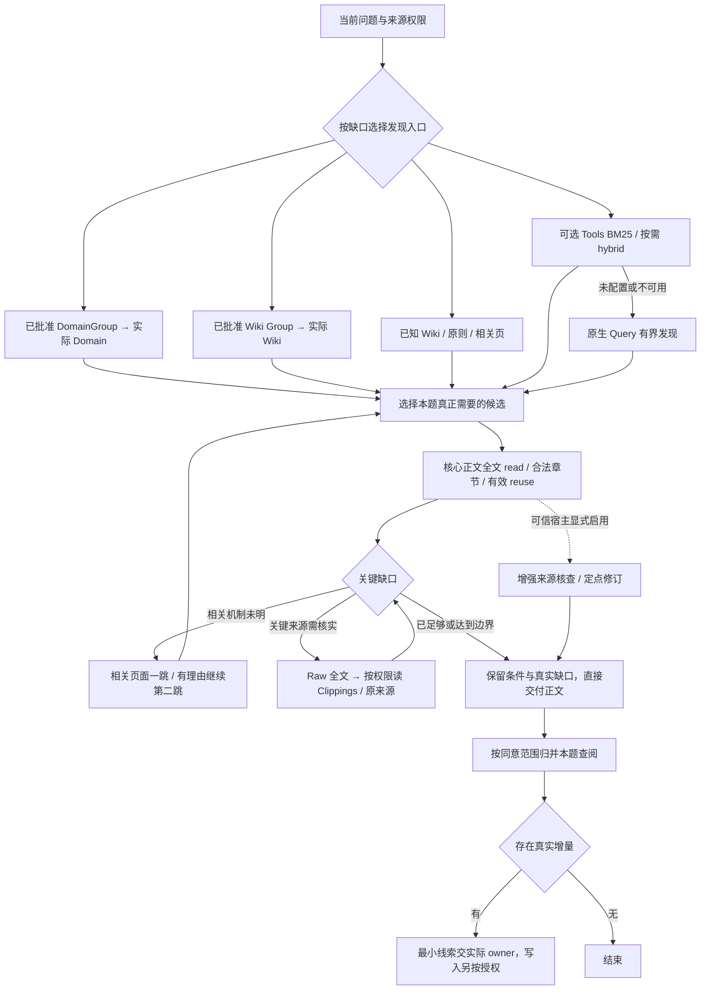

# Query 查阅全景

发现排名、Group 成员、导航元数据和标题都只是候选，不能冒充正文已读。每一跳都受同一问题、权限和预算约束；不同 Wiki 的 Raw/Clippings 可继续纵向追溯。原生查询不依赖 AWS、meta、Tools 或研究模块。

BM25 用词项匹配、词频饱和与文档长度校正帮助排序候选，无需向量模型；混合检索用于已配置且有跨表达缺口的任务。检索方式不替代全文阅读、来源核对和 Agent 的语义判断。安装不建索引、不下载模型，也不启用在线问答服务。
